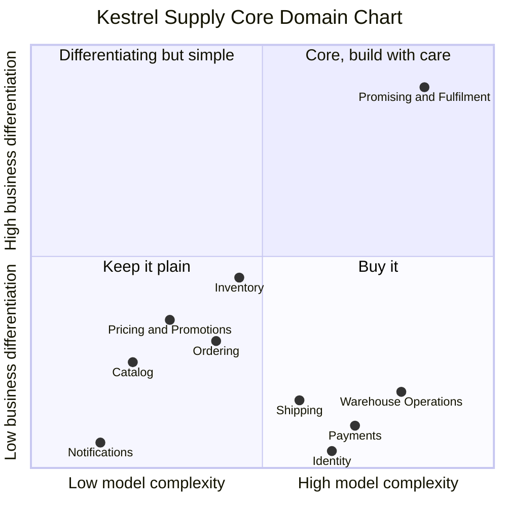

# 2. Subdomains: where to invest

A **subdomain** is a part of the business problem. Subdomains live in the **problem space**: they exist whether or not we write any software. Classifying them answers one practical question: *where should our best people and our most careful modelling go?*

| Type | Definition | What to do with it |
|------|------------|--------------------|
| **Core** | What makes the company win. Competitors cannot easily copy it. | Build it in-house, with your best developers, rich domain model, deep collaboration with experts. |
| **Supporting** | Specific to the business and necessary, but not a differentiator. | Build it, but keep it simple (CRUD or transaction scripts are often fine). Can be outsourced. |
| **Generic** | Every company has this problem in the same shape. | Buy or use a SaaS / open-source solution. Do not model it yourself. |

## Kestrel Supply's subdomains

| Subdomain | Type | Reasoning |
|-----------|------|-----------|
| **Order Promising & Fulfilment** | **Core** | Deciding *which warehouse ships which items, by when*, calculating a delivery date we will actually hit, and re-planning when things go wrong. This **is** the "date we show is the date it arrives" promise. It is complex, it changes often as the business learns, and no off-the-shelf product does it the Kestrel way. |
| Inventory | Supporting | Accurate stock per warehouse is essential for the promise, but the rules (on hand, reserved, adjustments) are standard bookkeeping. Its value is in being *correct*, not clever. |
| Ordering (cart, checkout, order lifecycle) | Supporting | Every shop has a cart and an order. Kestrel's checkout is ordinary apart from showing the promised date, which it gets from Fulfilment. |
| Catalog | Supporting | Product data and categories. Important for sales, but the logic is mostly data management. |
| Pricing & Promotions | Supporting | Kestrel competes on reliability, not price. Simple list prices and percentage promotions. (For a discount retailer this could be core.) |
| Warehouse Operations (picking, packing, bins) | Generic | Running a warehouse floor is a solved problem. Kestrel uses a commercial **WMS** (Warehouse Management System). |
| Payments | Generic | Handled by a Payment Service Provider (a Stripe-like PSP). |
| Shipping & Carrier Integration | Generic | Labels and tracking from carriers' APIs, through a shipping aggregator. |
| Identity & Customer Accounts | Generic | Login and accounts via an identity provider (Keycloak or Auth0). |
| Notifications | Generic | Emails and SMS via a delivery service. |
| Accounting & Invoicing | Generic | An accounting package. Out of scope for this tutorial. |

> Note that Warehouse Operations and Payments are *complex* but *not differentiating*. Complexity alone never makes something core. That is exactly why buying them is right: someone else has already paid for that complexity.

## Insights worth remembering

**1. "Core" is a business strategy decision, not a technical one.** Ordering is the subdomain most tutorials call core, because it looks central. For Kestrel it is supporting: if checkout were 10% better, customers would hardly notice. If the delivery promise slipped to 85%, the business would lose its reason to exist. Always ask *"what would hurt the business most if it were mediocre?"*

**2. The same subdomain can be core for one company and generic for another.** Pricing is supporting here. For a discount retailer with dynamic pricing, it would be the core. Never copy another company's classification.

**3. Core domains are usually small.** Order Promising & Fulfilment is maybe 10 to 15% of Kestrel's code. That is normal and good: it means you can afford to model it very carefully.

**4. Classifications move over time.** If Kestrel later builds its own warehouse robots, Warehouse Operations could become core. Revisit the chart once or twice a year.

**5. A supporting subdomain still needs to be correct.** Inventory is supporting, yet a wrong stock count breaks the core promise. "Supporting" means *simpler model*, not *lower quality*.

## Practical consequences for the code

| Type | How we will build it in Spring Boot |
|------|-------------------------------------|
| Core | Full tactical DDD: aggregates, value objects, domain events, rich behaviour, framework-free domain layer, many unit tests, Clean Architecture. |
| Supporting | Lighter: a simple domain model or even transaction scripts with Spring Data. Still behind clear module boundaries. |
| Generic | Thin integration code only: an anti-corruption layer that translates the vendor's model into ours. |

Next: [from subdomains to bounded contexts](03-bounded-contexts.md).
