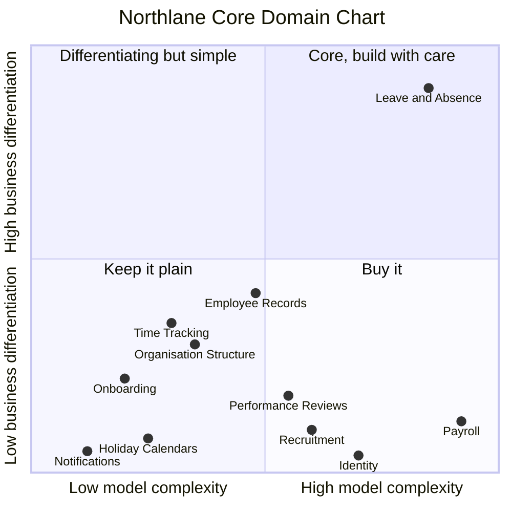

# 2. Subdomains: where to invest

A **subdomain** is a part of the business problem. Subdomains live in the **problem space**: they exist whether or not we write any software. Classifying them answers one practical question: *where should our best people and our most careful modelling go?*

| Type | Definition | What to do with it |
|------|------------|--------------------|
| **Core** | What makes the company win. Competitors cannot easily copy it. | Build it in-house, with your best developers, rich domain model, deep collaboration with experts. |
| **Supporting** | Specific to the business and necessary, but not a differentiator. | Build it, but keep it simple (CRUD or transaction scripts are often fine). Can be outsourced. |
| **Generic** | Every company has this problem in the same shape. | Buy or use a SaaS / open-source solution. Do not model it yourself. |

## Northlane's subdomains

| Subdomain | Type | Reasoning |
|-----------|------|-----------|
| **Leave & Absence Management** | **Core** | Entitlements, accruals, pro-rating, carry-over and expiry, public holidays per region, sickness during leave, approvals. This **is** the "every balance is correct in every country" promise. The rules are complex, change every time a law or a customer's policy changes, and competitors get them wrong. |
| Employee Records (core HR) | Supporting | The system of record for people, contracts, jobs and the org chart. Essential, and everything depends on it, but every HR product has it and customers do not choose Northlane for it. Its value is in being *accurate*, not clever. |
| Organisation Structure | Supporting | Departments, positions, reporting lines. Needed for approvals and reports. Standard. |
| Time Tracking | Supporting | Timesheets and overtime. Needed for time off in lieu and payroll, but simple. |
| Onboarding | Supporting | Checklists and tasks for new joiners. Useful, not differentiating. |
| Payroll | Generic | Calculating tax and social security per country is a regulated, solved problem. Northlane does **not** run payroll; it sends changes to each customer's payroll provider. |
| Recruitment | Generic | Customers already use an applicant tracking system (ATS). Northlane receives new hires from it. |
| Performance Reviews | Generic | Customers use dedicated review tools. Northlane does not compete here. |
| Public Holiday Calendars | Generic | Bought as a data feed per country and region. |
| Identity & Access | Generic | Single sign-on through the customer's identity provider. |
| Notifications | Generic | Email, Slack and Teams messages through a delivery service. |
| Subscription Billing | Generic | Northlane's own invoicing of its customers. Out of scope for this tutorial. |

> Payroll is the most complex subdomain on this chart, and it is generic. Complexity alone never makes something core. That is exactly why buying it is right: payroll providers have already paid for that complexity, in every country.

## Insights worth remembering

**1. "Core" is a business strategy decision, not a technical one.** Employee Records looks like the centre of an HR system: every other part depends on it, and it has the biggest database table. For Northlane it is supporting. If its employee profile page were 10% better, no customer would switch. If leave balances were wrong in Spain, customers would leave. Always ask *"what would hurt the business most if it were mediocre?"*

**2. "Everything depends on it" is not the same as "core".** Being upstream of everything makes Employee Records important and worth building carefully, but importance is not differentiation. Central, heavily used parts are often supporting.

**3. The same subdomain can be core for one company and generic for another.** Payroll is generic for Northlane. For a payroll company, it is the core. And if *your* company is not an HR vendor at all, **every** HR subdomain is supporting or generic for you, which is a strong argument for buying an HR system rather than building one.

**4. Core domains are usually small.** Leave & Absence is maybe 15% of Northlane's code. That is normal and good: it means you can afford to model it very carefully.

**5. Classifications move over time.** If Northlane decides to compete on working-time compliance (the EU requires employers to record working hours), Time Tracking could become core. Revisit the chart once or twice a year.

**6. A supporting subdomain still needs to be correct.** Employee Records is supporting, yet a wrong contract-hours value breaks the core promise. "Supporting" means *simpler model*, not *lower quality*.

## Practical consequences for the code

| Type | How we will build it in Spring Boot |
|------|-------------------------------------|
| Core | Full tactical DDD: aggregates, value objects, domain events, rich behaviour, framework-free domain layer, many unit tests, Clean Architecture. |
| Supporting | Lighter: a simple domain model or even transaction scripts with Spring Data. Still behind clear module boundaries. |
| Generic | Thin integration code only: an anti-corruption layer that translates the vendor's model into ours. |

Next: [from subdomains to bounded contexts](03-bounded-contexts.md).
