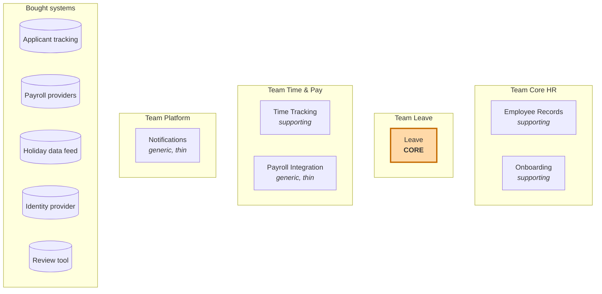

# 3. Bounded contexts

A **bounded context** is a boundary in the **solution space** inside which one model and one language apply consistently. Inside it, every term has exactly one meaning. Outside it, the same word may mean something else, and that is fine.

Subdomains are *discovered* (they are part of the business). Bounded contexts are *designed* (they are our decision about how to split the software). Ideally they line up one to one, but they do not have to.

## How we found the boundaries

These heuristics did most of the work. Use them at your job, in roughly this order:

1. **The language changes.** When "day" stops meaning *a calendar date* and starts meaning *one working day according to this person's contract*, you have crossed a boundary.
2. **Pivotal events.** `EmployeeHired`, `LeaveTaken` and `PayPeriodClosed` are hand-overs between different people and different concerns (see the [big picture](01-domain-and-big-picture.md#pivotal-events)).
3. **Different experts.** HR administrators, leave policy owners and payroll specialists each own different rules. A context should have one main group of experts you can ask.
4. **Different rates of change.** Leave rules change whenever a law or a customer's policy changes. A person's address field does not. Code that changes for different reasons should not be in the same model.
5. **Different consistency needs.** Recording a contract change and recalculating holiday entitlement do not need to happen in one database transaction; a few seconds of delay is fine. That is permission to separate them.
6. **Different data-protection needs.** Personal data (home address, national ID, bank details) needs strict access control and must be erasable under GDPR. Keeping it in one context, and only IDs everywhere else, makes that manageable. In HR systems this heuristic is unusually strong.
7. **Team ownership.** One context should be owned by one team. A context that two teams edit becomes a negotiation, not a model.

## The contexts



| Bounded context | Subdomain(s) it implements | Type | Team |
|-----------------|----------------------------|------|------|
| **Leave** | **Leave & Absence Management** | **Core** | Leave |
| Employee Records | Employee Records, Organisation Structure | Supporting | Core HR |
| Onboarding | Onboarding | Supporting | Core HR |
| Time Tracking | Time Tracking | Supporting | Time & Pay |
| Payroll Integration | Payroll (sends changes to the customer's provider) | Generic | Time & Pay |
| Notifications | Notifications | Generic | Platform |
| *(external)* Applicant tracking system | Recruitment | Generic, bought | Vendor |
| *(external)* Payroll providers | Payroll | Generic, bought | Vendor, one per country |
| *(external)* Holiday data feed | Public Holiday Calendars | Generic, bought | Vendor |
| *(external)* Identity provider | Identity & Access | Generic, bought | Customer's own |
| *(external)* Review tool | Performance Reviews | Generic, bought | Vendor |

> **Subdomain ≠ bounded context.** Organisation Structure is its own subdomain, but today it lives inside the Employee Records context because the same HR administrators maintain both and the rules are simple. If Northlane later adds workforce planning (budgeted positions, headcount approvals), Organisation becomes a candidate to split out. Making that call consciously is part of strategic design.

## Context cards

Each card says what the context **owns**, what it explicitly **does not own**, and the rules that matter. The "does not own" line is the one people skip, and it is the one that prevents boundaries from eroding.

### Leave (core)

**Purpose:** Know exactly how much leave every employee is owed, under the law of their country and their employer's policy, and handle requests and approvals against that.

| | |
|---|---|
| **Owns** | Leave types and policies (statutory rules per country plus company extras), entitlements, accruals, pro-rating, leave accounts and their ledgers, leave requests, approval routing, applying public holidays, year-end carry-over and expiry, the final leave settlement when someone leaves |
| **Does not own** | Personal data, contracts and contracted hours (receives a copy of the working pattern), the org chart (receives a copy of the reporting line), timesheets, pay, holiday calendar data (bought) |
| **Key concepts** | `LeavePolicy` (aggregate, versioned), `LeaveAccount` (aggregate: one per employee, leave type and leave year, holding a ledger), `LedgerEntry`, `LeaveRequest` (aggregate), `WorkingPattern`, `Deduction`, `ApprovalRoute`, `LeaveYear` |
| **Rules (invariants)** | A request deducts only the employee's working days in that period, minus public holidays in their region. A request cannot be approved if it would take the balance below what the policy allows. One employee's requests never overlap. Ledger entries are never changed or deleted; corrections are new entries. A request is always evaluated against the policy version in force for its dates. |
| **Inbound** | `EmployeeHired`, `EmploymentTermsChanged`, `EmployeeTransferred`, `EmploymentTerminated` (from Employee Records). `OvertimeApproved` (from Time Tracking). Public holidays (from the holiday feed, through an ACL). |
| **Outbound** | Balance and request API (used by the employee app and Time Tracking). `LeaveRequestApproved`, `ApprovedLeaveCancelled`, `LeaveTaken`, `UnpaidLeaveTaken`, `FinalLeaveBalanceSettled`. |
| **Style** | Rich domain model, full tactical DDD, framework-free domain layer. This is the context we build first, in module 2. |

### Employee Records (supporting)

**Purpose:** Be the single, trustworthy record of who works here, under which contract, in which role, reporting to whom, and since when.

| | |
|---|---|
| **Owns** | Personal details, employments and their terms (start date, job, country, contracted hours, working pattern, salary), org units, positions, reporting lines, effective-dated history of all of these, hires, transfers and terminations |
| **Does not own** | Leave balances, approvals, timesheets, pay calculation, user accounts |
| **Key concepts** | `Employee` (aggregate), `Employment`, `EmploymentTerms` (value object, effective-dated), `OrgUnit`, `Position`, `ReportingLine`, `EffectiveDate` |
| **Rules (invariants)** | At most one active employment per employee per legal entity. Changes are effective-dated and history is never overwritten. A termination date is never before the start date. Everyone has a reporting line except the top of the organisation. |
| **Inbound** | New hires from the applicant tracking system (through an ACL). Changes entered by HR administrators. |
| **Outbound** | Employee directory API (Open Host Service). `EmployeeHired`, `EmploymentTermsChanged`, `EmployeeTransferred`, `SalaryChanged`, `EmploymentTerminated`. |
| **Style** | A modest domain model. The interesting part is effective dating, not complex behaviour. |

### Time Tracking (supporting)

**Purpose:** Record hours worked and approve overtime.

| | |
|---|---|
| **Owns** | Timesheets, time entries, overtime approval |
| **Does not own** | Leave balances (it shows approved leave on the timesheet, read from Leave), time off in lieu balances (Leave owns them) |
| **Key concepts** | `Timesheet` (aggregate, one per employee per week), `TimeEntry`, `Overtime` |
| **Outbound** | `TimesheetApproved`, `OvertimeApproved` |

### Payroll Integration (generic, thin)

**Purpose:** Make sure every pay-relevant change reaches the customer's payroll provider for the right pay period, in the provider's format.

| | |
|---|---|
| **Owns** | Pay calendars and cut-off dates per customer, collected pay changes, export batches, the record of what was sent |
| **Does not own** | Any pay calculation. Any of the facts it exports; it only collects and translates them. |
| **Key concepts** | `PayPeriod`, `PayChange`, `ExportBatch`, `PayrollProvider` |
| **Rules** | A change that arrives after the cut-off goes into the next period, never lost and never sent twice. |
| **Style** | Mostly translation code: one adapter per payroll provider. |

### Onboarding, Notifications (supporting / generic)

| Context | Purpose | Talks to the rest of the system in terms of |
|---------|---------|---------------------------------------------|
| Onboarding | Checklists and tasks before and after a new joiner's first day | Listens to `EmployeeHired`; publishes `OnboardingCompleted` |
| Notifications | Emails and chat messages | Listens to other contexts' events and sends messages |

## Alternatives we considered

**One big "Employee" context.** This is how most HR systems are built: one `Employee` table with 200 columns (address, salary, holiday balance, manager, overtime, onboarding status, payroll ID, ...). Every team edits it, every change risks breaking someone else, and a GDPR erasure request becomes an archaeology project. This "God entity" is exactly what DDD exists to prevent, and HR is where it is most common.

**Leave inside Employee Records.** Tempting, because leave "belongs to the employee". Rejected: it would put the core next to the supporting system of record, the two change for different reasons (law and policy versus HR admin needs), and they have different experts.

**Leave and Time Tracking merged into "Absence & Time".** Defensible: both deal with hours and days. We kept them apart because their users and experts differ (policy owners versus team leads), and Time Tracking is simple while Leave is the core. If Northlane starts competing on working-time compliance, this decision should be revisited.

**Organisation as its own context.** Deferred, see the note above.

## Bounded context ≠ microservice

A bounded context is a **model boundary**, not a deployment unit. Northlane will start as a **modular monolith**: one Spring Boot application with one top-level package per context, separate database schemas, and ArchUnit tests that forbid one context from reaching into another's internals.

```
com.northlane
├── employees
├── leave
├── time
├── onboarding
├── payroll
└── notifications
```

Contexts talk only through their published API or events, exactly as they would over a network. If one later needs to scale or deploy independently, it can be extracted into its own service without redesigning the model. Getting the boundaries right is the hard part; moving them into separate processes is comparatively easy.

Next: [the context map](04-context-map.md).
