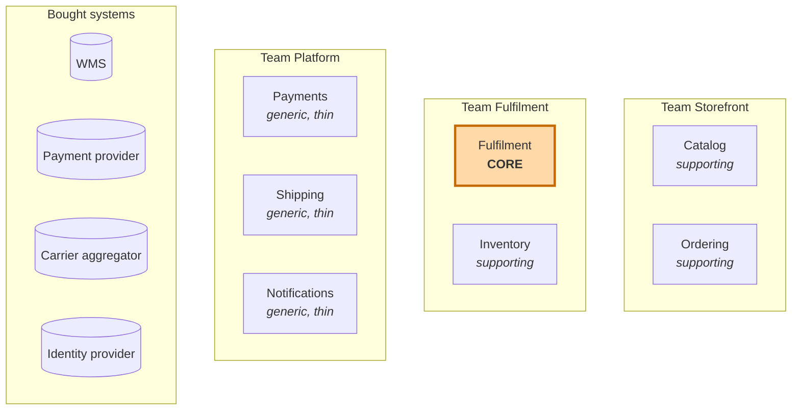

# 3. Bounded contexts

A **bounded context** is a boundary in the **solution space** inside which one model and one language apply consistently. Inside it, every term has exactly one meaning. Outside it, the same word may mean something else, and that is fine.

Subdomains are *discovered* (they are part of the business). Bounded contexts are *designed* (they are our decision about how to split the software). Ideally they line up one to one, but they do not have to.

## How we found the boundaries

These heuristics did most of the work. Use them at your job, in roughly this order:

1. **The language changes.** When "order" stops meaning *what the customer bought* and starts meaning *what the warehouse must pick*, you have crossed a boundary.
2. **Pivotal events.** `OrderPlaced` and `ShipmentDispatched` are hand-overs between different people and different concerns (see the [big picture](01-domain-and-big-picture.md#pivotal-events)).
3. **Different experts.** Merchandisers, fulfilment planners and warehouse supervisors each own different rules. A context should have one main group of experts you can ask.
4. **Different rates of change.** Promise rules change weekly as the business learns. Product attributes change rarely. Code that changes for different reasons should not be in the same model.
5. **Different consistency needs.** Placing an order and reserving stock do not need to happen in one database transaction; a few seconds of delay is acceptable. That is permission to separate them.
6. **Team ownership.** One context should be owned by one team. A context that two teams edit becomes a negotiation, not a model.

## The contexts



| Bounded context | Subdomain(s) it implements | Type | Team |
|-----------------|----------------------------|------|------|
| Catalog | Catalog, Pricing & Promotions | Supporting | Storefront |
| Ordering | Ordering | Supporting | Storefront |
| **Fulfilment** | **Order Promising & Fulfilment** | **Core** | Fulfilment |
| Inventory | Inventory | Supporting | Fulfilment |
| Payments | Payments (wraps the PSP) | Generic | Platform |
| Shipping | Shipping & Carrier Integration (wraps the aggregator) | Generic | Platform |
| Notifications | Notifications | Generic | Platform |
| *(external)* WMS | Warehouse Operations | Generic, bought | Vendor |
| *(external)* Identity provider | Identity & Customer Accounts | Generic, bought | Vendor |

> **Subdomain ≠ bounded context.** Pricing & Promotions is its own subdomain, but today it lives inside the Catalog context because the rules are simple and the same team owns both. If Kestrel later adds dynamic pricing, Pricing becomes a candidate to split out. Making that call consciously is part of strategic design.

## Context cards

Each card says what the context **owns**, what it explicitly **does not own**, and the rules that matter. The "does not own" line is the one people skip, and it is the one that prevents boundaries from eroding.

### Fulfilment (core)

**Purpose:** Turn a placed order into one or more shipments that arrive on the promised date, and keep that promise when reality changes.

| | |
|---|---|
| **Owns** | Delivery promise quotes, the fulfilment plan for each order, warehouse choice (sourcing), splitting into shipments, cut-off times, re-planning, back-orders |
| **Does not own** | Prices, payment, stock counts (asks Inventory), how the warehouse floor picks items (WMS), carrier labels (Shipping) |
| **Key concepts** | `Fulfilment` (aggregate, one per order), `PlannedShipment`, `DeliveryPromise`, `SourcingPolicy`, `CutOffTime`, `WarehouseCalendar` |
| **Rules (invariants)** | Every order line is allocated to exactly one planned shipment. A planned shipment ships from exactly one warehouse. A shipment that has been released to the warehouse cannot be re-planned, only cancelled by the WMS. A promise quote is only valid for 20 minutes. |
| **Inbound** | `OrderPlaced`, `CancellationRequested` (from Ordering). Stock availability (query to Inventory). Pick/pack/dispatch updates (from WMS, through an ACL). |
| **Outbound** | Promise API (used by Ordering at checkout). `FulfilmentPlanned`, `OrderBackordered`, `DeliveryPromiseBroken`, `ShipmentDispatched`, `CancellationAccepted` / `CancellationRejected`. |
| **Style** | Rich domain model, full tactical DDD, framework-free domain layer. |

### Ordering (supporting)

**Purpose:** Let the shopper build a cart, check out, and track their order as one thing they bought.

| | |
|---|---|
| **Owns** | Cart, checkout, the `Order` and its customer-facing status, order history, price snapshot at purchase time |
| **Does not own** | Delivery date calculation (asks Fulfilment), stock, product master data (copies what it needs), payment processing |
| **Key concepts** | `Cart`, `Order` (aggregate), `OrderLine`, `Money`, `ShippingAddress`, `PromisedDeliveryDate`, `OrderStatus` |
| **Rules (invariants)** | An order has at least one line. An order total equals the sum of its lines minus discounts. An order can only be placed with a valid (non-expired) promise quote and an authorised payment. Prices on an order never change after it is placed. |
| **Inbound** | Product and price data (from Catalog). Promise quote (from Fulfilment). Payment authorisation result (call to Payments at checkout). `ShipmentDispatched`, `OrderBackordered`, `CancellationAccepted` (from Fulfilment). `ParcelDelivered` (from Shipping). |
| **Outbound** | `OrderPlaced`, `CancellationRequested`, `OrderCompleted`. |
| **Style** | A modest domain model. It is the first context we build in module 2 because its rules are easy to understand while learning the tactical patterns. |

### Inventory (supporting)

**Purpose:** Know how much of each item is in each warehouse, and how much of it is already promised to someone.

| | |
|---|---|
| **Owns** | Stock on hand per SKU per warehouse, reservations, stock adjustments, available-to-promise |
| **Does not own** | Which warehouse *should* ship an order (that is a Fulfilment decision), bin locations (WMS) |
| **Key concepts** | `StockItem` (aggregate, per SKU and warehouse), `Reservation`, `StockAdjustment`, `AvailableToPromise` |
| **Rules (invariants)** | Reserved quantity never exceeds quantity on hand. Available to promise = on hand − reserved − safety stock. |
| **Inbound** | Reserve and release commands (from Fulfilment). Goods received and stock count corrections (from WMS, through an ACL). |
| **Outbound** | Availability query API. `StockReserved`, `StockShortageDetected`. |
| **Style** | Simple model, mostly arithmetic and concurrency control (optimistic locking on `StockItem`). |

### Catalog (supporting)

**Purpose:** Be the source of truth for what Kestrel sells and at what price.

| | |
|---|---|
| **Owns** | Products, variants, SKUs, categories, descriptions, images, list prices, promotions |
| **Does not own** | Stock levels, delivery dates |
| **Key concepts** | `Product`, `Variant`, `Sku`, `Category`, `ListPrice`, `Promotion` |
| **Outbound** | Product and price API (Open Host Service). `ProductPublished`, `PriceChanged`. |
| **Style** | CRUD with Spring Data is fine here. |

### Payments, Shipping, Notifications (generic, thin)

These exist only to **protect our model from vendors** and give the rest of the system one stable interface.

| Context | Wraps | Speaks to the rest of the system in terms of |
|---------|-------|---------------------------------------------|
| Payments | Payment provider | `PaymentAuthorised`, `PaymentCaptured`, `PaymentRefunded` |
| Shipping | Carrier aggregator | `ParcelLabelled`, `ParcelInTransit`, `ParcelDelivered` |
| Notifications | Email and SMS service | Listens to other contexts' events and sends messages |

If Kestrel swaps its payment provider, only the inside of Payments changes. Nothing in Ordering should ever mention the vendor's names, status codes or IDs.

## Alternatives we considered

**One big "Order" context.** Ordering and Fulfilment would share one `Order` class. Rejected: that class would collect checkout fields, warehouse fields and carrier fields, and every change to promise rules would risk breaking checkout. This is the classic "God entity" that DDD exists to prevent.

**Fulfilment and Inventory merged.** Defensible, since they are owned by the same team and work closely together. We kept them apart because Inventory is bookkeeping (it must be exact and changes rarely) while Fulfilment is decision-making (it changes weekly). Merging them would put the core model next to concurrency-heavy stock arithmetic. If the team were smaller, merging would be a reasonable choice.

**Cart as its own context.** Rejected for now: the cart uses the same language as the order, and the same team owns both. Splitting would add integration cost without a clear benefit.

## Bounded context ≠ microservice

A bounded context is a **model boundary**, not a deployment unit. Kestrel will start as a **modular monolith**: one Spring Boot application with one top-level package per context, separate database schemas, and ArchUnit tests that forbid one context from reaching into another's internals.

```
com.kestrel
├── catalog
├── ordering
├── fulfilment
├── inventory
├── payments
├── shipping
└── notifications
```

Contexts talk only through their published API or events, exactly as they would over a network. If one later needs to scale or deploy independently, it can be extracted into its own service without redesigning the model. Getting the boundaries right is the hard part; moving them into separate processes is comparatively easy.

Next: [the context map](04-context-map.md).
