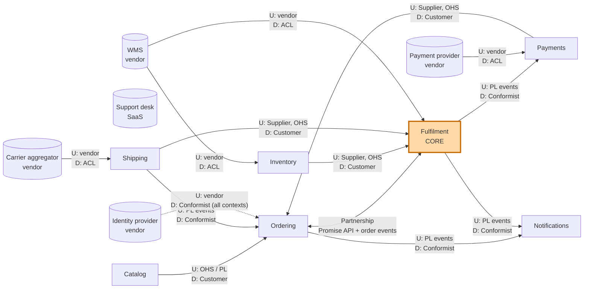

# 4. The context map

Bounded contexts never live alone. A **context map** shows how they relate: who depends on whom, whose model wins, and how each side protects itself. It is as much about **teams and politics** as about code.

## Upstream and downstream

In every relationship one side is **upstream (U)** and the other **downstream (D)**. Upstream means *"my model influences yours"*: if the upstream changes its API or events, the downstream has to adapt.

> **This is about model influence, not data flow.** Data often flows both ways. Ordering sends `OrderPlaced` to Fulfilment *and* receives `ShipmentDispatched` back. The question to ask is: *"if this side changes, who has to change with it?"*

## The patterns

| Pattern | What it means | Use it when |
|---------|---------------|-------------|
| **Partnership** | Two teams succeed or fail together and plan changes jointly. | Two contexts genuinely co-evolve and the teams can coordinate closely. |
| **Shared Kernel** | Two contexts share a small piece of model code. | Rarely. Only for a tiny, stable piece, owned jointly. Every change needs both teams. |
| **Customer / Supplier** | Downstream (customer) has a voice in upstream's (supplier's) plans. | Same company, upstream team is willing to prioritise downstream needs. |
| **Conformist** | Downstream adopts upstream's model as it is. | Upstream will not change for you, and its model is good enough. Cheap. |
| **Anti-Corruption Layer (ACL)** | Downstream translates upstream's model into its own. | Upstream's model is foreign or messy and would pollute yours. Essential for protecting a core domain. |
| **Open Host Service (OHS)** | Upstream offers one well-defined API for all consumers. | Many downstreams need the same thing. |
| **Published Language (PL)** | A documented, versioned exchange format (event schema, JSON schema). | Usually together with OHS or events. |
| **Separate Ways** | No integration at all. | The cost of integrating is higher than the benefit. |

## Kestrel Supply's context map



Arrows point from upstream to downstream. The Support desk has no arrow on purpose: it is Separate Ways (see below).

## Each relationship, and why

### Catalog → Ordering: Open Host Service + Published Language, Customer/Supplier

Catalog publishes a product and price API that any context can use. Ordering calls it while the shopper browses and, **at checkout, copies the product name, SKU and unit price into the order line**. After that, the order never looks at Catalog again.

*Why copy instead of referencing?* An order is a legal record of what the customer agreed to pay. If a merchandiser changes the price tomorrow, yesterday's order must not change. Copying a snapshot is not duplication; it is a different fact ("the price *we agreed* on") from Catalog's fact ("the price *today*").

### Ordering ⇄ Fulfilment: Partnership

This is the most important relationship, and the only Partnership on the map. It has two directions:

- **At checkout (synchronous):** Ordering asks Fulfilment's **Promise API** "when can these lines reach this postcode?" Fulfilment returns a `DeliveryPromise` quote valid for 20 minutes. Here Fulfilment is upstream.
- **After checkout (asynchronous):** Ordering publishes `OrderPlaced` carrying the promise quote ID. Fulfilment turns it into a plan and later publishes `ShipmentDispatched`, `OrderBackordered`, `DeliveryPromiseBroken`. Ordering updates the customer-facing status.

*Why Partnership?* The checkout experience and the promise logic are two halves of the company's main selling point. Any change to how promises work (for example, adding evening delivery slots) changes both checkout and fulfilment at the same time. The Storefront and Fulfilment teams plan these changes together.

*The risk:* a Partnership is expensive. Both teams must release in step, and a two-way dependency can turn into a distributed monolith. We contain it by keeping the contract tiny (one query, a handful of events) and versioning the event schemas. If the two teams ever stop coordinating well, the fallback is to make Fulfilment the clear upstream (OHS) and Ordering a customer.

### Inventory → Fulfilment: Customer/Supplier with OHS

Fulfilment asks Inventory for available-to-promise and sends reserve/release commands. Inventory is the supplier, Fulfilment the customer: when Fulfilment needs something new (say, reserved-until timestamps), Inventory's backlog takes it seriously. Same team, so this is easy in practice.

### Payments → Ordering, Fulfilment → Payments

At checkout, Ordering calls Payments to **authorise** the card (Payments is supplier, Ordering customer). Card rules say we may only **capture** money when goods are dispatched, so Payments listens to Fulfilment's `ShipmentDispatched` event. For that event Payments simply **conforms** to Fulfilment's published language: it needs only an order ID and an amount, so a translation layer would add nothing.

### Shipping → Fulfilment and Ordering

When a shipment is packed, Fulfilment asks Shipping to book a parcel and print a label (Customer/Supplier). Shipping later publishes `ParcelInTransit` and `ParcelDelivered`; Ordering conforms to those events to show tracking and close the order.

### WMS → Fulfilment and Inventory: Anti-Corruption Layer

The warehouse system is a vendor product with its own vocabulary: *outbound orders*, *waves*, *LPNs* (license plate numbers), *item masters*, numeric status codes. We cannot change it, and its model is nothing like ours.

If Fulfilment conformed to it, the core domain would start talking about waves and status code 40. So both Fulfilment and Inventory have an **ACL**: an adapter that translates the WMS's messages into our own language at the boundary.

| WMS says | Fulfilment's ACL translates to |
|----------|--------------------------------|
| Outbound order created, status 10 | `ShipmentReleasedToWarehouse` |
| Status 40 (picked), short-pick on line 2 | `ShipmentPicked` + `StockShortageDetected` |
| LPN closed, status 60 | `ShipmentPacked` |
| Trailer departed | `ShipmentDispatched` |

**An ACL belongs to the downstream context it protects.** Fulfilment and Inventory each translate only what they need. There is no shared "WMS integration service" that both depend on, because that would become a second model of the warehouse.

### Payment provider → Payments, Carrier aggregator → Shipping: ACL

Same reasoning. These thin contexts are essentially ACLs with a stable API on top. Swapping vendors changes one context only.

### Identity provider → everyone: Conformist

All contexts accept the identity provider's tokens and use its subject ID as the `CustomerId`. Building a translation layer would cost more than it saves: we only need one ID and a few claims, and the provider's model of a user is perfectly reasonable. **Conformist is a legitimate, deliberate choice** when the upstream model is good enough and does not touch your core.

### Ordering and Fulfilment → Notifications: Conformist to Published Language

Notifications subscribes to other contexts' public events and sends emails. It owns templates and delivery preferences, nothing else. It conforms to the event schemas because they are already designed for outside consumers.

### Support desk: Separate Ways

Customer service agents use a SaaS help desk. We considered syncing orders into it. Instead, each ticket simply contains a link to the order in our back-office UI. No integration, no sync bugs, almost the same value. **Separate Ways is underused:** not every relationship needs code.

### What is *not* on the map: Shared Kernel

We have no Shared Kernel. Even something as innocent as `Money` is defined separately in each context that needs it. A shared `Money` library sounds harmless, but the moment one context needs currency conversion rules or rounding policy for invoices, every context is forced to take that change. The only things shared are the **published event schemas** (the Published Language), which are versioned contracts, not shared code.

## How to choose a pattern (decision guide)

```
Is the other side a vendor or legacy system you cannot change?
├── Yes → Is its model clean and does it stay out of your core?
│         ├── Yes → Conformist
│         └── No  → Anti-Corruption Layer
└── No (internal team)
    ├── Do both sides have to change together for the same business reason?
    │   └── Yes → Partnership (keep the contract tiny)
    ├── Does upstream serve many consumers?
    │   └── Yes → Open Host Service + Published Language
    ├── Will upstream prioritise your needs?
    │   ├── Yes → Customer/Supplier
    │   └── No  → Conformist, or ACL if you are protecting a core model
    └── Is the integration worth its cost at all?
        └── No  → Separate Ways
```

Next: [the ubiquitous language](05-ubiquitous-language.md).
