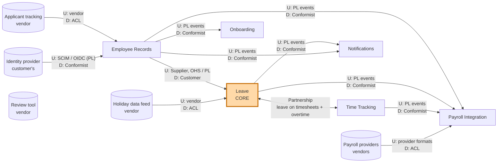

# 4. The context map

Bounded contexts never live alone. A **context map** shows how they relate: who depends on whom, whose model wins, and how each side protects itself. It is as much about **teams and politics** as about code.

## Upstream and downstream

In every relationship one side is **upstream (U)** and the other **downstream (D)**. Upstream means *"my model influences yours"*: if the upstream changes its API or events, the downstream has to adapt.

> **This is about model influence, not data flow.** Northlane *sends* data to payroll providers, yet the providers are **upstream**: they dictate the file format, and when they change it, Northlane has to change. The question to ask is: *"if this side changes, who has to change with it?"*

## The patterns

| Pattern | What it means | Use it when |
|---------|---------------|-------------|
| **Partnership** | Two teams succeed or fail together and plan changes jointly. | Two contexts genuinely co-evolve and the teams can coordinate closely. |
| **Shared Kernel** | Two contexts share a small piece of model code. | Rarely. Only for a tiny, stable piece, owned jointly. Every change needs both teams. |
| **Customer / Supplier** | Downstream (customer) has a voice in upstream's (supplier's) plans. | Same company, upstream team is willing to prioritise downstream needs. |
| **Conformist** | Downstream adopts upstream's model as it is. | Upstream will not change for you, and its model is good enough. Cheap. |
| **Anti-Corruption Layer (ACL)** | Downstream translates upstream's model into its own. | Upstream's model is foreign or messy and would pollute yours. Essential for protecting a core domain. |
| **Open Host Service (OHS)** | Upstream offers one well-defined API for all consumers. | Many downstreams need the same thing. |
| **Published Language (PL)** | A documented, versioned exchange format (event schema, JSON schema, or an industry standard). | Usually together with OHS or events. |
| **Separate Ways** | No integration at all. | The cost of integrating is higher than the benefit. |

## Northlane's context map



Arrows point from upstream to downstream, which is not always the direction data flows. The review tool has no arrow on purpose: it is Separate Ways (see below).

## Each relationship, and why

### Employee Records → Leave: Customer/Supplier with Open Host Service and Published Language

Employee Records publishes `EmployeeHired`, `EmploymentTermsChanged`, `EmployeeTransferred` and `EmploymentTerminated` as versioned events. Leave is its most important customer: when Leave needs a new field (say, the employee's region, because Spanish public holidays differ between Madrid and Catalonia), the Core HR team prioritises it.

Leave **keeps its own copy** of the few facts it needs: country and region, working pattern, reporting line, start and end dates. It does not call Employee Records every time it calculates a deduction.

*Why copy instead of calling?* Three reasons. Leave keeps working when Employee Records is down. Leave needs the facts *as they were on a given date* (effective-dated), shaped for its own calculations. And Leave never needs the employee's home address or salary, so it never holds them (see [D9](06-design-decisions.md#d9-personal-data-lives-in-one-place)).

### Leave ⇄ Time Tracking: Partnership

This is the only Partnership on the map, and it has two directions:

- Time Tracking shows approved leave on the timesheet, so nobody is flagged as missing hours while on holiday. Here Leave is upstream.
- When overtime is approved, Leave turns it into *time off in lieu* according to the policy. Here Time Tracking is upstream.

*Why Partnership?* Features in this area cross both contexts: hourly leave, half days, flexible working patterns. Each changes how leave is deducted and how timesheets look at the same time. The Leave and Time & Pay teams plan those changes together.

*The risk:* a Partnership is expensive. Both teams must release in step, and a two-way dependency can turn into a distributed monolith. We contain it by keeping the contract tiny (one query, two events) and versioning the event schemas. If the teams stop coordinating well, the fallback is to make Leave the clear upstream and Time Tracking a customer.

### Applicant tracking → Employee Records: Anti-Corruption Layer

The ATS speaks of *candidates*, *requisitions*, *offers* and *stages*, with its own IDs and custom fields per customer. None of that belongs in Employee Records. An ACL turns an accepted offer into a *pending hire* in our language: person, start date, job, country, contracted hours. If a customer switches ATS vendor, only the ACL changes.

### Holiday data feed → Leave: Anti-Corruption Layer

The feed has its own codes for regions, distinguishes "observances" from real days off, and marks some holidays as half days or optional. Leave must not depend on those details. The ACL translates the feed into Leave's own `PublicHolidayCalendar`: for a region, the dates that are non-working. **The core domain is always protected by an ACL from vendors.**

### Leave, Employee Records, Time Tracking → Payroll Integration: Conformist to Published Language

Payroll Integration listens to `SalaryChanged`, `UnpaidLeaveTaken`, `FinalLeaveBalanceSettled`, `OvertimeApproved` and others, and collects them into pay periods. It simply **conforms** to the published events: they are already designed for outside consumers, and Payroll Integration has no rich model of its own to protect.

### Payroll providers → Payroll Integration: Anti-Corruption Layer (data flows out)

Each country's payroll provider has its own import format, its own codes for pay elements ("unpaid leave" might be code `U07` for one provider and `ABS-UNP` for another) and its own rules for corrections. The providers are upstream: they will not change their formats for Northlane. Payroll Integration has one ACL adapter per provider that translates our `PayChange` into the provider's format. This is the clearest example of **"upstream" meaning model influence, not data direction**.

### Identity provider → Employee Records: Conformist to a standard Published Language

Customers bring their own identity provider. Northlane uses OIDC for login and SCIM (an industry-standard protocol) to create and remove user accounts when people join and leave. Both standards are Published Languages that someone else designed. Conforming to them is cheap and correct; inventing a translation would add nothing. **Conformist is a legitimate, deliberate choice** when the upstream model is good enough and does not touch your core.

### Onboarding and Notifications: Conformist

Onboarding creates a checklist when it receives `EmployeeHired`. Notifications sends messages on `LeaveRequestApproved` and others. Both need little more than an ID, a date and a name, so they conform to the published events.

### Review tool: Separate Ways

Customers use a separate tool for performance reviews. We considered syncing review scores into Employee Records. Nobody could name a decision Northlane would make with them, so there is no integration: the review tool gets users through the customer's identity provider and that is all. **Separate Ways is underused:** not every relationship needs code.

### What is *not* on the map: Shared Kernel

We have no Shared Kernel. Even something as innocent as `EmployeeId` handling or a `DateRange` value object is defined separately in each context that needs it. A shared library sounds harmless, but the moment Leave needs half-day ranges or Payroll needs pay-period rounding, every context is forced to take that change. The only things shared are the **published event schemas** (the Published Language), which are versioned contracts, not shared code.

## How to choose a pattern (decision guide)

```
Is the other side a vendor, a standard, or a legacy system you cannot change?
├── Yes → Is its model clean and does it stay out of your core?
│         ├── Yes → Conformist
│         └── No  → Anti-Corruption Layer
└── No (internal team)
    ├── Do both sides have to change together for the same business reason?
    │   └── Yes → Partnership (keep the contract tiny)
    ├── Does upstream serve many consumers?
    │   └── Yes → Open Host Service + Published Language
    ├── Will upstream prioritise your needs?
    │   ├── Yes → Customer/Supplier
    │   └── No  → Conformist, or ACL if you are protecting a core model
    └── Is the integration worth its cost at all?
        └── No  → Separate Ways
```

Next: [the ubiquitous language](05-ubiquitous-language.md).
